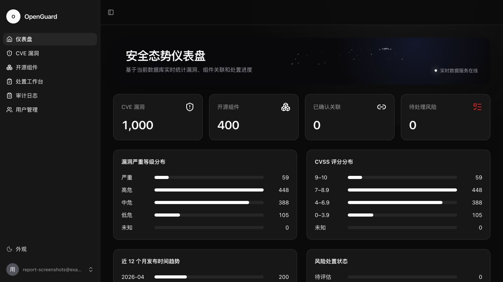
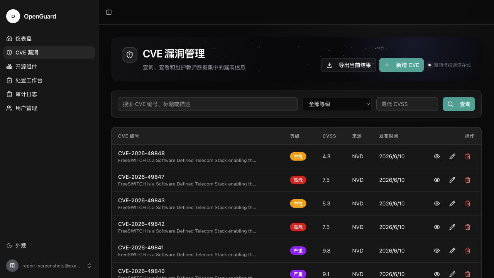
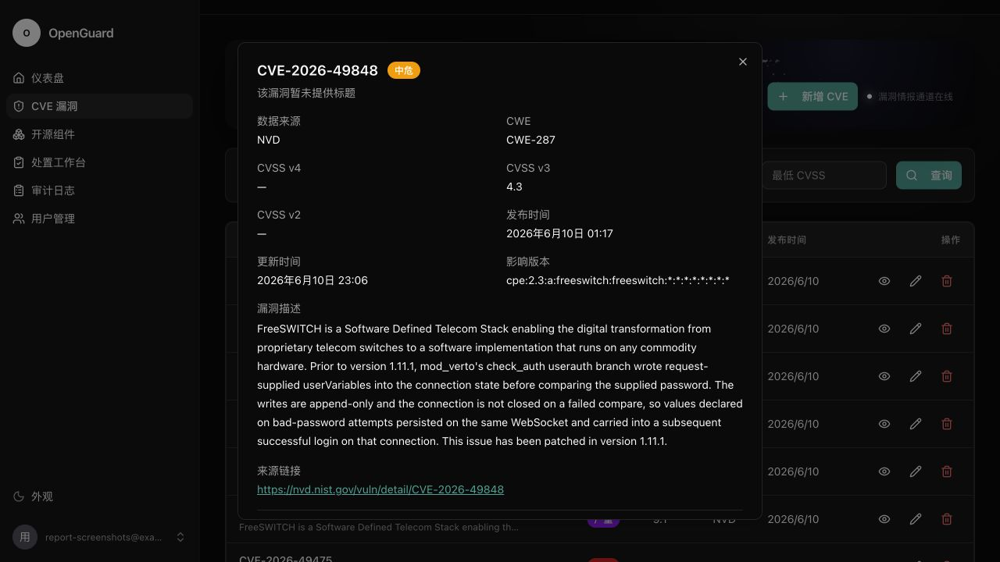
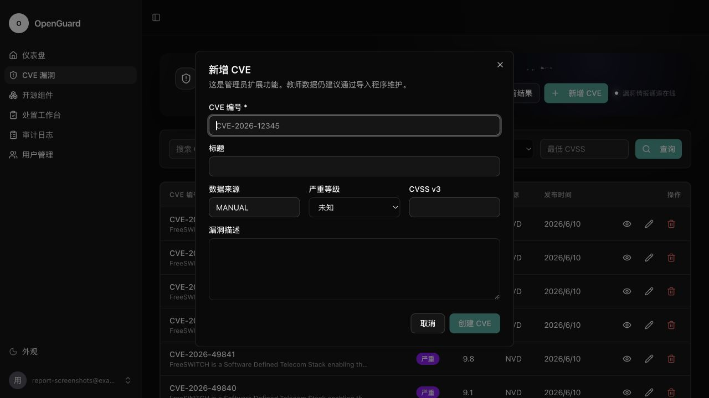
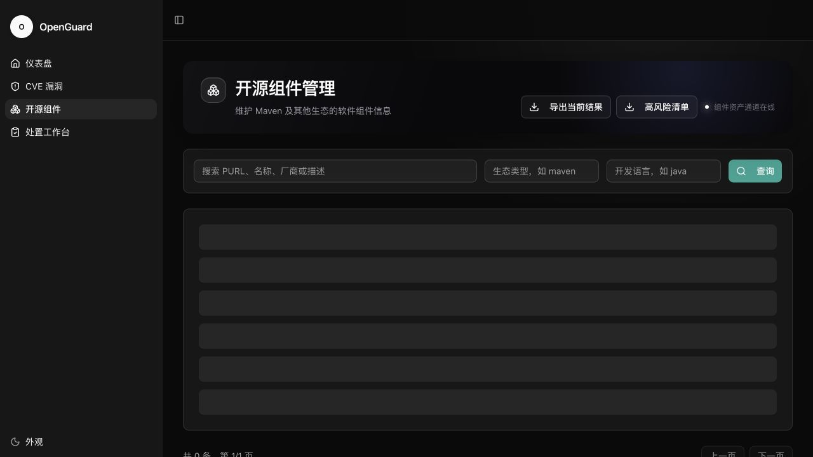
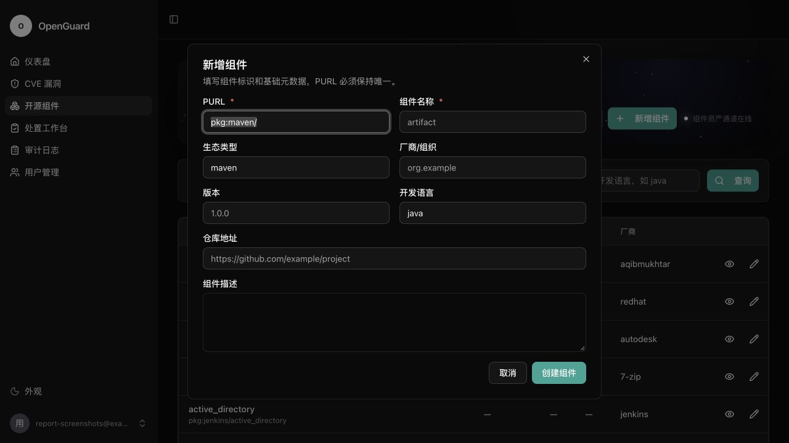
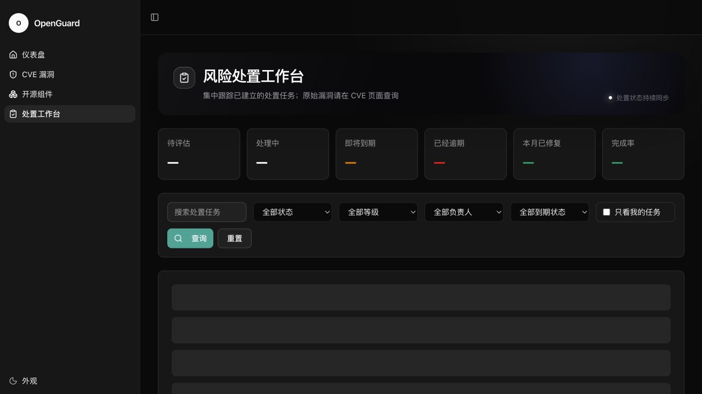
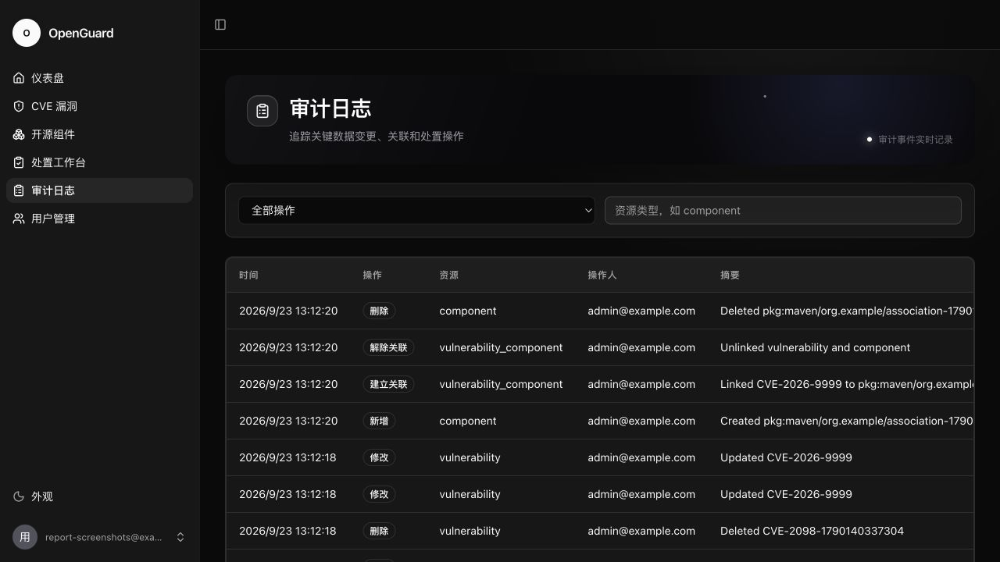

# 《现代 Web 开发》实践作业一实验报告

> 姓名：`[待填写]`　学号：`[待填写]`　班级：`[待填写]`　指导教师：`[待填写]`

## 1. 需求理解与任务拆分

本作业要求实现基于 Web 的 CVE 与 Maven/开源组件信息管理系统。系统必须包含前端、后端和数据库，前端通过 HTTP 调用 REST API，数据修改必须持久化。CVE 模块的基础要求是查询、修改和删除，组件模块必须具备完整 CRUD。本项目在完成基础要求后，进一步将管理员手工新增 CVE 作为扩展功能实现。此外还需提交可复现的数据库初始化方案、README、实验报告，并完成 5–8 分钟演示。

项目被拆分为九个阶段：需求与底座选择、安全基线、数据模型、教师数据导入、CVE 后端、组件后端、核心前端、关联与风险处置、权限审计与交付收尾。每阶段同步完成实现、测试和工作日志。

## 2. 技术与底座选择

项目采用 FastAPI 官方 `full-stack-fastapi-template` 作为通用全栈底座，主要技术为 React + TypeScript、FastAPI + SQLModel、PostgreSQL + Alembic，以及 Docker Compose。

前期考察了 Dependency-Track、DefectDojo、ODYSAFE-CVE 和 dependency-analyzer。这些项目更接近成熟漏洞扫描或软件成分分析平台，体量较大且包含作业不要求的扫描、同步逻辑。最终选用通用 CRUD 模板，因为它已打通认证、REST API、数据库、迁移和测试框架，又不会将作业误做成漏洞扫描器。成熟项目仅用于参考仪表盘、关联和风险流程。

## 3. 系统结构与数据设计

React 页面通过 `/api/v1` 向 FastAPI 发出 HTTP 请求；FastAPI 使用 Pydantic/SQLModel 完成校验、鉴权和数据库读写；PostgreSQL 负责持久化；Alembic 管理迁移。前端客户端根据 OpenAPI 生成，减少接口类型偏差。

核心表为 `vulnerability`、`component`、`vulnerability_component`、`remediation` 和 `audit_log`。业务表使用 UUID 内部主键，`cve_id` 和 `purl` 分别作为唯一业务键。用户表增加 `ADMIN`、`SECURITY`、`VIEWER` 角色。完整字段映射见 `docs/DATA_MODEL.md`。

## 4. 教师数据导入

教师 SQL 使用 MySQL 语法，不能直接交给 PostgreSQL。项目保留原文件并实现独立流式解析程序，处理数据库前缀、转义、日期、NULL、JSON 数组、CVSS 和枚举转换。程序按 `cve_id` 与 `purl` 幂等更新，支持 `--dry-run`。

最终成功导入 1000 条 CVE 和 398 条组件，失败 0；重复导入时新增和更新均为 0，验证不会制造重复记录。

## 5. 核心功能与创意扩展

### 5.1 CVE 管理

登录用户可以分页查询、按关键词/等级/CVSS 筛选并查看详情；管理员可以新增、修改和删除。手工新增 CVE 是题目基础要求之外的扩展，表单会校验 `CVE-YYYY-NNNN...` 标识格式、必填摘要与 CVSS 范围；重复 CVE 返回 HTTP 409，非管理员无法新增。所有写操作均记录审计日志。

### 5.2 组件管理

组件支持完整 CRUD、关键词及生态筛选。新增和修改会校验名称、PURL 和仓库 URL；重复 PURL 返回 HTTP 409；删除需要二次确认。

### 5.3 创意功能

- 安全态势仪表盘：展示严重等级、CVSS、趋势、处置状态和高风险组件排行。
- 漏洞组件关联：根据本地 CPE、名称和厂商给出建议，必须人工确认，不执行漏洞扫描。
- 风险处置：维护待评估、处理中、已修复和已忽略状态。
- 三级角色和审计：前后端双重鉴权，关键操作可追溯。
- CSV 数据交换：组件导入、当前筛选结果与高风险清单导出。
- CVE 手工新增：管理员可补充本地漏洞记录，具备格式、范围、重复性和权限校验。

## 6. 一次 HTTP 请求链路

以修改 CVE 为例：管理员提交 React 编辑表单；TanStack Query 通过生成客户端发送带 JWT 的 `PATCH /api/v1/vulnerabilities/{id}`；FastAPI 解析 JWT、查询用户并判断管理员权限；Pydantic 校验请求体；SQLModel 更新 PostgreSQL，同时新增 `UPDATE` 审计日志并提交事务；后端返回更新后的 JSON；前端使缓存失效并重新查询。页面刷新后仍能读取新值，证明数据已持久化。

## 7. AI 使用、判断与验证

开发中使用 Codex 辅助需求梳理、开源项目比较、实现、调试、测试和文档。代表性问题包括：“作业是否要求漏洞扫描器”“寻找适合二次开发的全栈 CRUD 项目”“CVE 新增是否适合作为扩展功能”“如何设计组件关联但不实现扫描”。

AI 建议没有被直接照搬。例如发现 dependency-analyzer 的核心是扫描后，重新对照评分项并否决原选型；对题目中未强制要求的 CVE 新增，则将其作为带完整校验、权限与审计的扩展功能；匹配建议只用于人工关联，避免变成题目范围外的 Agent 或扫描能力。

验证方式包括人工审查权限和事务代码、Alembic 迁移检查、真实数据库数量核对、pytest、Playwright、前端生产构建、Ruff 和 mypy。测试结束后还会清理临时数据并恢复管理员状态。

## 8. 主要问题与解决

1. 首次登录返回 500：原因是未执行数据库迁移；运行 `scripts/prestart.sh` 后解决。
2. 早期误选扫描器：重读评分项后将底座改为通用全栈模板。
3. 测试影响开发账号：增加独立 `app_test` 数据库，失效 JWT 对应用户不存在时返回标准 401。
4. MySQL SQL 与 PostgreSQL 不兼容：实现转换导入器，并用试运行及重复导入验证。
5. 真实数据与 E2E 查询碰撞：测试使用唯一标记，并在用例结束后恢复数据。

## 9. 项目运行与功能截图

以下截图均来自本地 Docker Compose 环境中实际运行的系统，页面数据由 FastAPI 从 PostgreSQL 读取，不是静态原型或后期合成图。截图时使用临时演示账号，不展示 `.env` 或密码。

### 9.1 安全态势仪表盘

### 9.2 CVE 查询、详情与手工新增

### 9.3 组件管理

### 9.4 风险处置与审计

## 10. 测试结果

- 教师数据：1000 条 CVE、398 条组件，导入失败 0。
- 后端 pytest：最终回归 **104 项通过**，总覆盖率 **91%**。
- 前端 Playwright：测试集共 **73 项浏览器测试**，最终回归通过。
- Ruff、Ruff format、mypy、ty 与前端生产构建：通过。

运行截图已纳入本报告；提交前只需补充姓名、学号、班级和指导教师，并根据学校模板调整封面排版。

## 11. 总结

项目先完整满足三层结构、CVE 管理、组件 CRUD、持久化和文档要求，再围绕开源组件风险管理增加可解释的扩展。主要收获是通过字段映射、幂等导入、权限边界、审计和自动化测试，将通用模板改造成可运行、可讲解、可验证的完整系统。
